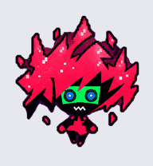
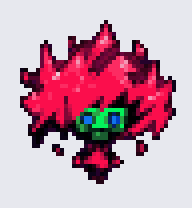
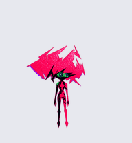
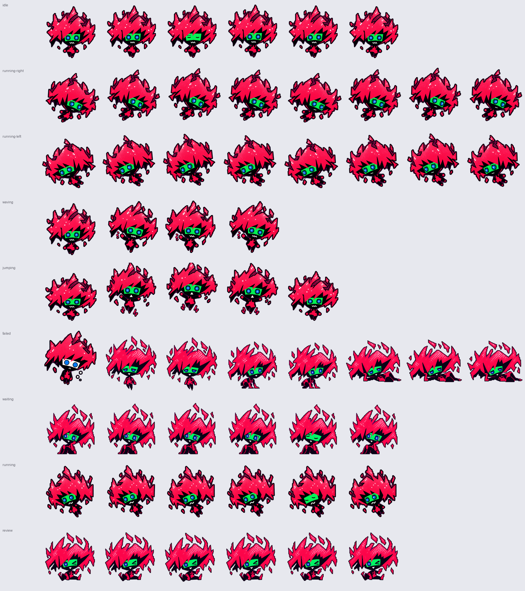

# Cyberpunk: Edgerunners 2 — Capri Desktop Pet

[简体中文](README.md) · **[Download latest release](https://github.com/X1a0heZzzz/capri-desktop-pet/releases/latest)**

A fan-made desktop companion of **Capri / 摩羯 from Cyberpunk: Edgerunners 2**.

Six production stages, preserved as source artwork and three legacy
8×9 desktop-pet packages: clear chibi (recommended), pixel chibi and refined anime.



## Meet Capri

**Capri / 摩羯 is the digital personality construct connected to D in Cyberpunk: Edgerunners 2.** The anime takes place in the Night City setting of Cyberpunk 2077 and is produced by CD PROJEKT RED and TRIGGER. [Official series site](https://www.cyberpunk.net/en/edgerunners2)

This fan-made pet adapts her distinctive pink, shard-like hair, dark geometric body and contrasting eye panels into anime and chibi desktop companions. The chibi proportions and resting poses are this project's interpretation, separate from the character's story.

<details><summary>Background: the chip and Project Capricorn (setting spoilers; no ending spoilers)</summary>

Capri is linked to a host through a data chip. D's encounter with her connects his story to Project Capricorn and engram technology. See the [character background and source notes](docs/CHARACTER.md) for context and the distinction between series lore and desktop-pet adaptation.

</details>

Created and maintained by **[X1a0heZzzz](https://github.com/X1a0heZzzz)**. This is an unofficial fan project, not an official character product.

## Start

Download a package from the latest release, or download and extract the repository.
Open `index.html` locally for an offline, interactive nine-state preview. Choose
`pets/capri-clear/` for the recommended package, `pets/capri-pixel/` for the pixel
edition or `pets/capri-anime/` for the refined anime edition. Read
[installation](docs/INSTALL.md) for host-specific limits.

| Package | Preview | Notes |
| --- | --- | --- |
| **capri-clear** (recommended) |  | Chibi source art adapted directly; most hair texture and expression detail |
| capri-pixel |  | The clear edition reduced to a 48×52 logical grid and a 32-colour palette, shown at 4× |
| capri-anime |  | Refined anime edition with the slender original-style body |

All three sheets are transparent, 1536×1872 pixels, 8 columns × 9 rows with 192×208
cells, not a newly generated sixteen-direction v2 set.

## Motion

All three packages share one choreography, timed for the default host speed of Codex
and Petdex (about one second per loop): idle is a calm float with breathing and a blink;
travel rows look and lean towards the direction of movement, with running-left mirrored
in place; jumping has anticipation, lift and a landing on the same baseline; failed is a
startle-droop-kneel-flop collapse; waiting is a chin-in-hand daydream; running (work) is a
busy bob; review is a teasing wink and point.

Every frame comes from the drawn source poses. The only additions are whole-pose bob,
lean and squash/stretch, independent hair-shard drift, in-place mirroring and closed-eye
lines painted over the original eyes. The soft dark smudge left by background removal was
cleaned, and the clear edition's violet rest-pose rim was unified with its dark outline.
The original slow-timed key-pose packages remain in the
[v1.0.0 release](https://github.com/X1a0heZzzz/capri-desktop-pet/releases/tag/v1.0.0).



The six stages are initial study, rest pose study, refined anime, chibi source art,
pixel export and clear export. Stages 1, 2 and 4 are design sources, not six separate
working applications.

## Build

Python 3.12 and `pip install -r requirements.txt`, then:

```sh
python scripts/build.py
python scripts/validate.py
python scripts/render_previews.py
python scripts/release.py
```

Builds go to `dist/rebuilt/`; packaged releases and SHA-256 checksums go to `dist/`.
No image generation, paid API, installer, host binary or local account state is required.
See [build notes](docs/BUILD.md) for the choreography pipeline and reproduction limits.

Code and documentation: [MIT](LICENSE). Character images and identity are **excluded**
from MIT; see [ASSET_RIGHTS.md](ASSET_RIGHTS.md). Unofficial, AI-assisted fan art;
no claim of character ownership, endorsement or commercial clearance.
