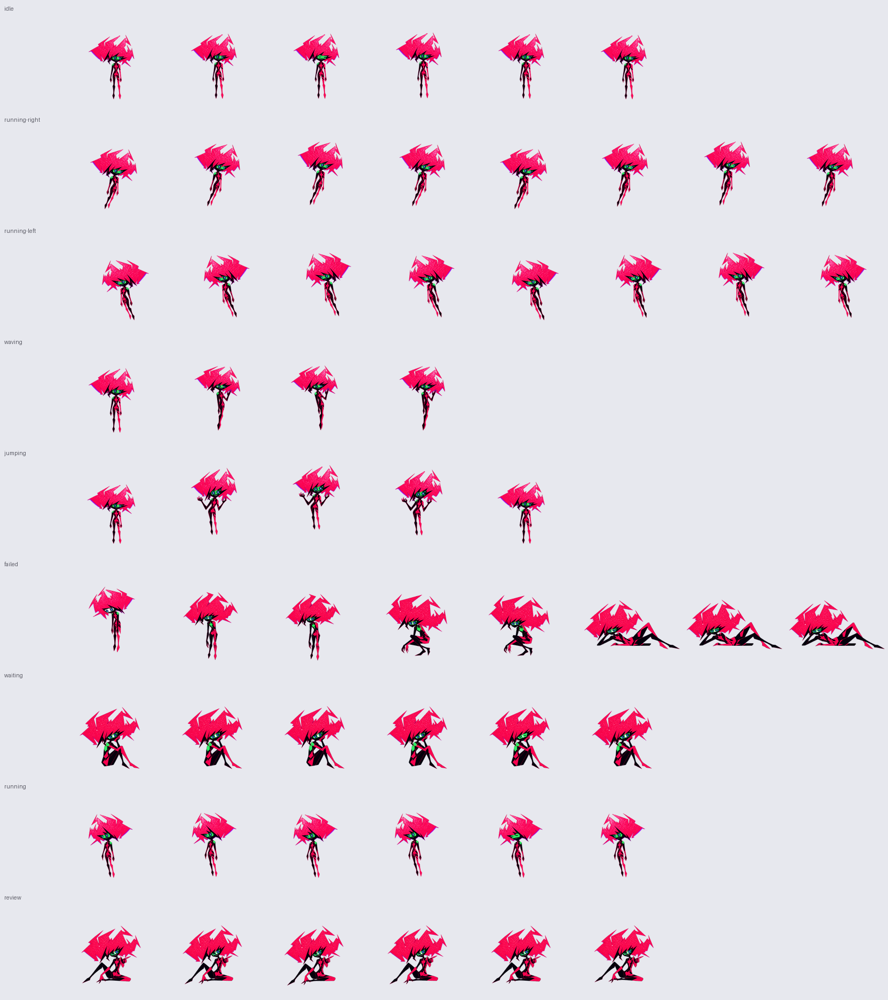
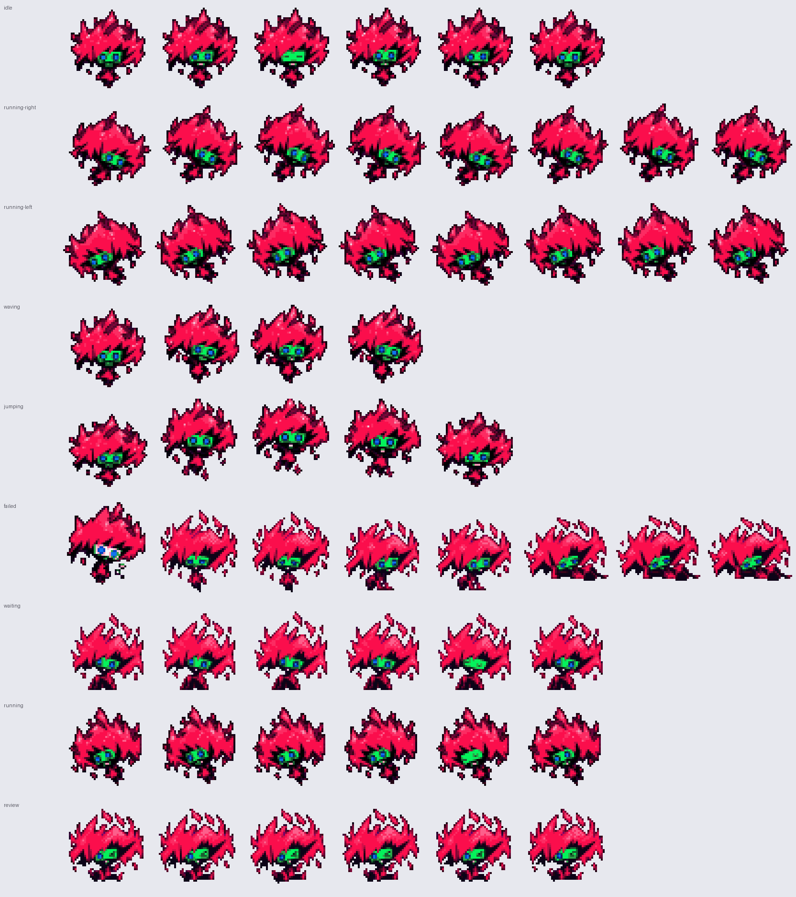
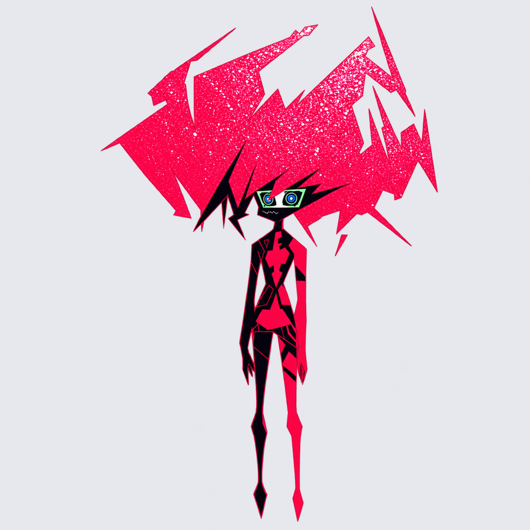
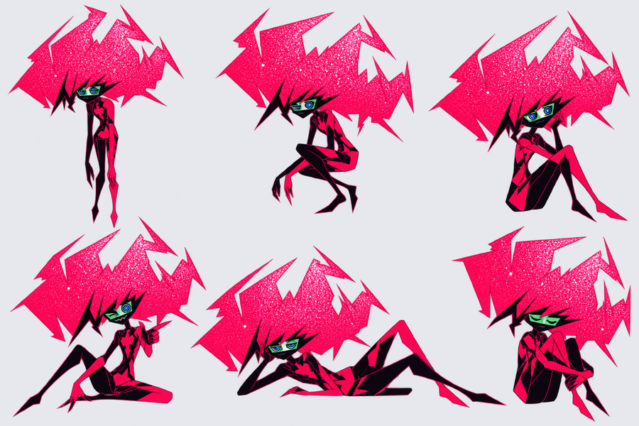
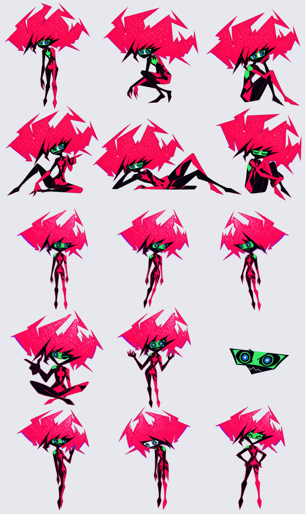
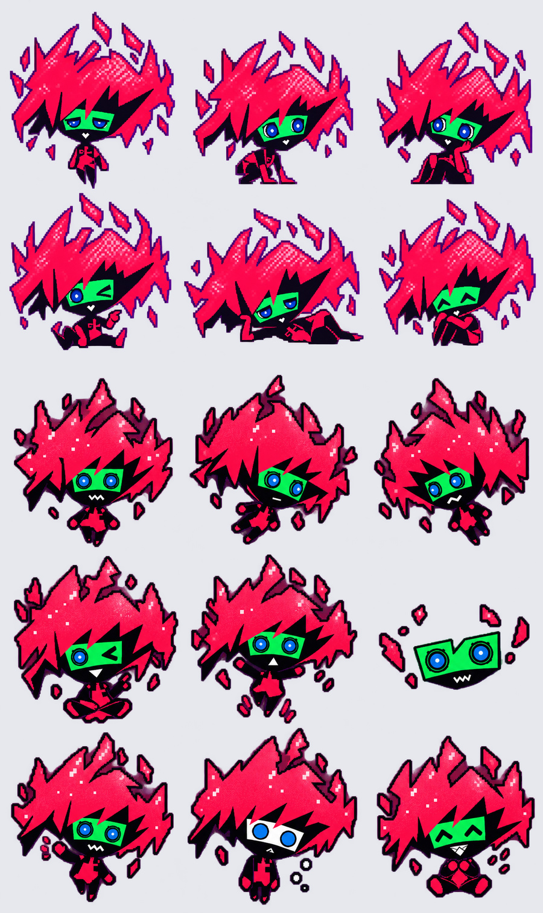
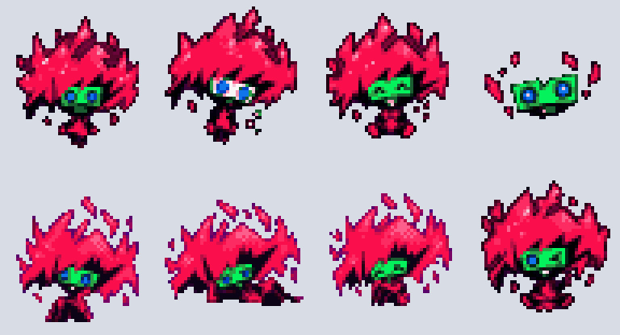
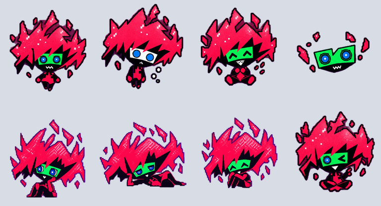

<div align="center">

# 《赛博朋克：边缘行者2》摩羯 Capri 桌宠

**把《赛博朋克：边缘行者2》中的数字人格摩羯 Capri 带到桌面。**

六个制作阶段 · 清晰Q版／像素Q版／动漫版 · 非官方同人项目

[English](README.en.md) · **[下载最新版](https://github.com/X1a0heZzzz/capri-desktop-pet/releases/latest)** · [版本画廊](#六个制作阶段) · [安装说明](docs/INSTALL.md) · [离线预览源码](index.html) · [角色素材说明](ASSET_RIGHTS.md)


</div>

保留摩羯从初稿、休息姿态、动漫细化到 Q 版原稿、像素化和清晰桌宠的全部现存制作阶段。
默认推荐 **Q版清晰原稿**：保留头发纹理、白色/绿色眼框、嘴形，以及托腮、侧躺、打趣等姿态。

三套桌宠包使用同一套动作编排，按 Codex / Petdex 默认约 1 秒一轮的播放速度设计：
待机是呼吸 + 眨眼，移动时视线和身体朝向前进方向，累了会吓一跳、跪坐、最后躺倒摆烂。
所有帧都来自原稿姿势，没有重新绘制角色。

这是**角色包与制作工具仓库**。桌面悬浮、拖动、置顶和任务状态由 Codex / Petdex 等兼容宿主提供。

## 摩羯 Capri 是谁？

**摩羯（Capri）是《赛博朋克：边缘行者2》（Cyberpunk: Edgerunners 2）中与 D 的故事紧密相连的数字人格构造体。** 剧集发生在《赛博朋克 2077》的夜之城世界观中，由 CD PROJEKT RED 与 TRIGGER 联合制作。[动画官网](https://www.cyberpunk.net/zh-cn/edgerunners2)

粉红色的碎片状头发、黑色几何身体、白色／绿色眼框和蓝色眼睛，是本项目参考角色画面保留的视觉特征。桌宠希望把这位来自夜之城、拥有自身意志的数字角色带到桌面上；Q版比例与休息动作属于本项目的同人演绎。

<details><summary>角色背景：芯片、D 与摩羯计划（含剧情设定剧透，不涉及结局）</summary>

Capri 通过数据芯片与宿主相联系。D 接入芯片后，与这位数字人格建立联系；她的存在牵涉「摩羯计划」（Project Capricorn）及人格印记（engram）技术，而不是普通的桌面助手设定。[背景资料与来源](docs/CHARACTER.md)

</details>

项目由 **[X1a0heZzzz](https://github.com/X1a0heZzzz)** 制作与维护，为非官方同人桌宠；角色背景与新增桌宠动作分别说明。完整介绍见 [角色背景与改编说明](docs/CHARACTER.md)。

## 直接开始

1. 从 [Releases](https://github.com/X1a0heZzzz/capri-desktop-pet/releases/latest) 下载单个角色包，或下载仓库 ZIP 并解压。
2. 双击仓库根目录 `index.html`：网页完全离线，可切换三套包和九种状态、暂停、调速。
3. 导入桌宠：选择 `pets/capri-clear/`，按 [安装说明](docs/INSTALL.md) 操作。
4. 想要复现导出：见 [构建说明](docs/BUILD.md)。无需模型密钥，也不会联网生成新图。

## 三套桌宠包

| 包 | 预览 | 说明 |
| --- | --- | --- |
| **capri-clear** ★ 推荐 |  | Q版清晰原稿直接适配，头发纹理和表情最完整 |
| capri-pixel |  | 清晰版缩到 48×52 逻辑像素、32 色调色板，4 倍放大 |
| capri-anime |  | 动漫细化版，细长身材、原片风格 |

三套图集均为 **1536×1872 / 8列×9行 / 192×208 每帧**，带透明 PNG 和无损 WebP。

## 九种动作

| 行 | 状态 | 内容 |
| --- | --- | --- |
| 0 | idle | 悬浮呼吸、碎发飘动、眨一次眼 |
| 1 / 2 | running-right / running-left | 视线朝前进方向，前倾小跳两步；向左为逐帧镜像 |
| 3 | waving | 抬手打招呼，身体左右摆 |
| 4 | jumping | 下蹲蓄力 → 举手跳起 → 落回原基线 |
| 5 | failed | 吓一跳（白眼框）→ 垂头 → 跪坐 → 侧躺摆烂 |
| 6 | waiting | 托腮发呆，轻微呼吸并眨眼 |
| 7 | running | 手忙脚乱地上下颠（工作中，不是跑步） |
| 8 | review | 眨眼指人，歪头点评 |


<details><summary>动漫版与像素版的全部状态</summary>




</details>

动作只用了原稿姿势的整体位移、倾斜、挤压拉伸、碎发独立飘动、镜像，以及在原有眼睛位置画的闭眼线。
原稿抠图留下的暗色污边已清理，清晰版休息姿态的紫边统一成深色描边。
`animation-manifest.json` 的时序与宿主默认值一致（待机 280/110/110/140/140/320 毫秒），离线预览看到的就是桌面上的节奏。
本发布是 **legacy 8×9 图集**，没有新增 16 向 look 动作，不冒充新版 v2 角色。

## 六个制作阶段

| 阶段 | 展示 | 原稿 / 可用包 |
| --- | --- | --- |
| ① 最初角色稿 | [查看](docs/gallery/01-initial.jpg) | [原始 PNG](sources/artwork/01-initial/character.png)，造型研究 |
| ② 休息姿态初稿 | [查看](docs/gallery/02-rest-draft.jpg) | [原始 PNG](sources/artwork/02-rest-draft/rest-poses.png)，姿态研究 |
| ③ 动漫细化版 | [查看](docs/gallery/03-anime-refined.jpg) | [原稿](sources/artwork/03-anime-refined/) · [桌宠包](pets/capri-anime/) |
| ④ Q版清晰原稿 | [查看](docs/gallery/04-chibi-originals.jpg) | [表情与休息原稿](sources/artwork/04-chibi-originals/)，⑤⑥ 的来源 |
| ⑤ Q版像素桌宠 | [查看](docs/gallery/05-pixel-petdex.jpg) | [桌宠包](pets/capri-pixel/)，48×52 逻辑单帧、4倍放大 |
| ⑥ Q版清晰桌宠 ★ | [查看](docs/gallery/06-clear-codex.jpg) | [推荐桌宠包](pets/capri-clear/)，192×208 单帧 |

<details><summary>展开全部版本</summary>








</details>

六个阶段不等于六套独立可运行角色包。①②④保留设计稿；③⑤⑥附完整图集。
旧的 `Capri-Codex` 和后来的「Q版清晰原稿」使用相同图集，只改了名称与描述，合并为⑥。
最初按慢速时序做的关键姿态版本保留在 [v1.0.0 Release](https://github.com/X1a0heZzzz/capri-desktop-pet/releases/tag/v1.0.0)，变化见 [版本记录](CHANGELOG.md)。

## 仓库结构

```text
pets/              三套可直接使用的角色文件夹
sources/artwork/   六阶段中的高清生成原稿
sources/frames/    两套造型的透明切帧及相对坐标
sources/pixel/     像素调色板与 v1.0 像素逻辑图集（存档）
sources/prompts/   制作提示词（含 Q 版两张原稿和面部修订）
scripts/           构建、动作编排、预览渲染、校验、发行打包工具
docs/              安装、构建、画廊及项目参考说明
archive/metadata/  历史包的原始元数据
catalogue.json     版本映射、状态时序及像素校验指纹
index.html         可离线播放的预览页
```

## 参与与许可

欢迎改进安装文档、兼容性与构建工具，见 [CONTRIBUTING.md](CONTRIBUTING.md)。
工具代码和文档采用 [MIT](LICENSE)；角色及图片素材单独遵循 [ASSET_RIGHTS.md](ASSET_RIGHTS.md)，未取得官方角色授权。

展示结构参考 [VPet](https://github.com/LorisYounger/VPet) 与 [OpenPets](https://github.com/OpenPetsHQ/openpets)，
角色包格式参考 [Petdex](https://github.com/crafter-station/petdex)。没有复制上述项目的角色图片或程序代码。
